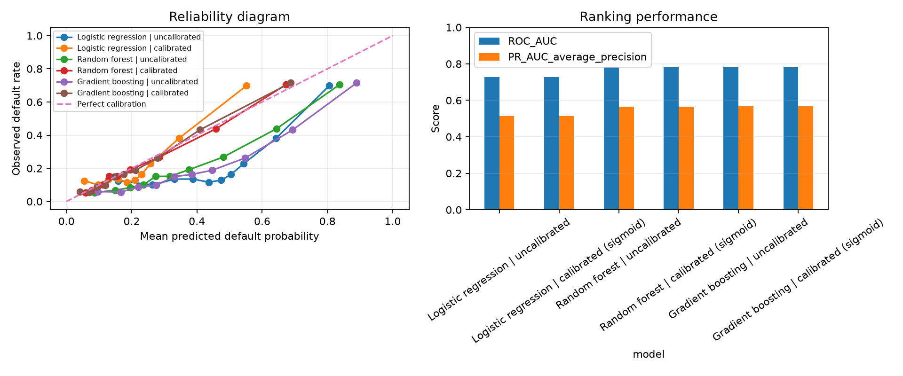
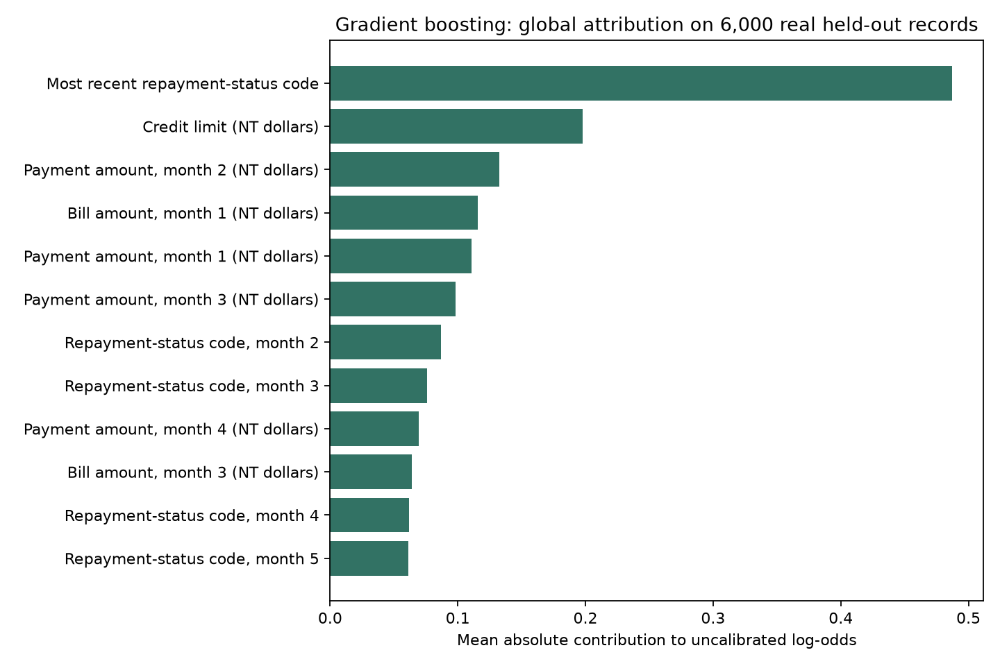

# Credit Default Prediction, Calibration and Explanations

Compare three machine-learning models on real credit-card records, check their probability estimates, and explain the boosted model's predictions.

All reported training, comparisons and explanations use **30,000 actual historical clients from UCI**. No generated borrowers are used for the reported results. This is real historical data, not a live lending feed. No API key or paid AI service is required.

## Data and experiment

[UCI Default of Credit Card Clients](https://archive.ics.uci.edu/dataset/350/default+of+credit+card+clients) contains 30,000 clients from Taiwan, 23 features and an observed next-month default rate of 22.12%. Repayment histories cover April–September 2005. Features include credit limit, bill amounts, payment history and demographic codes.

The experiment compares logistic regression, random forest and histogram gradient boosting. Each run uses a stratified split:

| Partition | Actual records | Purpose |
|---|---:|---|
| Training | 18,000 | Fit preprocessing and base models |
| Calibration | 6,000 | Fit sigmoid probability calibration only |
| Test | 6,000 | Evaluate predictions and explain held-out records |

All three models share the same split within a run. Three preselected seeds (42, 43, 44) measure sensitivity to the random split. Hyperparameters are fixed, not selected using test scores. The test set never fits preprocessing, base models or calibration.

The original workbook is downloaded from UCI and cached locally. Its SHA-256 checksum, software versions and model parameters are recorded in each run's metadata. Raw data and trained models are excluded from Git.

## Results across three splits

These are the calibrated models. Full results contain both raw and calibrated predictions for every seed.

| Model | Mean ROC-AUC | Mean Brier score | Mean log loss | Mean calibration error |
|---|---:|---:|---:|---:|
| Logistic regression | 0.7230 | 0.1465 | 0.4691 | 0.0521 |
| Random forest | 0.7797 | 0.1358 | 0.4316 | 0.0158 |
| Gradient boosting | 0.7782 | 0.1351 | 0.4314 | 0.0123 |

Higher ROC-AUC is better; lower Brier score, log loss and calibration error are better.

**Boosting did not clearly beat random forest.** The forest ranked clients slightly better on average; boosting had slightly lower probability errors after calibration. Differences are small and are not established as statistically significant. In seed 42, boosting achieved ROC-AUC 0.7851 versus 0.7845 for the forest; in seed 43 the forest ranked better.

The raw weighted models overestimated default probabilities. Boosting's mean Brier score fell from 0.1745 to 0.1351 after calibration. The default 0.5 classification threshold is a reporting convention, not an optimised lending decision.

[Full comparison and per-seed results](results/comparison/README.md)



The older two-model seed-42 results remain directly under `results/`. The extension is under `results/comparison/`.

## Explain actual held-out predictions

Tree SHAP explains the boosted model on **all 6,000 actual test records for seed 42**. Five real held-out rows are also selected with a fixed random seed for individual explanations, without choosing only correct predictions.

Each example includes its actual feature values, observed default outcome, raw and calibrated probabilities, and the contribution of every feature. The base score plus all 23 contributions reconstructs the model's uncalibrated score. The maximum observed log-odds reconstruction error was approximately `1.2e-14`.

Positive contributions raise the model's score; negative contributions lower it. They are measured in **log-odds, not percentage points**. They explain the uncalibrated model, not its calibration layer, and do not show why a person actually defaulted.



The largest average attribution in this run was the most recent repayment-status code (`PAY_0`), followed by credit limit (`LIMIT_BAL`). Correlated bill and payment features can share attribution in assumption-dependent ways.

[Five actual held-out examples](results/comparison/seed-42/explanations/README.md)

Tree SHAP uses the training observations' tree-path counts as its reference distribution. No artificial background borrowers are generated. `source_row_id` is the zero-based workbook data-row index, not the original client ID; the corresponding Excel row number is also exported.

## Run it

Python 3.10 or newer. First-time data download requires internet; later runs use the cached workbook.

```powershell
py -3.12 -m venv .venv
.\.venv\Scripts\Activate.ps1
python -m pip install -e ".[dev,explain]"

# Full comparison and real-record explanations
credit-risk --seeds 42 43 44 --explain --output-dir outputs/comparison --model-dir models/comparison

# One split without explanations
credit-risk --seed 42
```

On macOS/Linux use `python3 -m venv .venv` and `source .venv/bin/activate`.

If downloading fails, put UCI's workbook in `data/raw/default_of_credit_card_clients.xls`. The required `xlrd` reader is now installed with the project.

Full runs save per-client predictions, split memberships, all SHAP values and actual held-out inputs under `outputs/`. The repo includes the smaller comparison tables, charts, run metadata and five-row explanation export, not every generated file.

## Tests

```powershell
# Mathematical unit checks, not evidence of model performance
pytest -q

# Enable integration checks on the actual UCI workbook
$env:CREDIT_RISK_REAL_DATA = "1"
pytest -q
```

The original four unit tests use small constructed arrays to check metrics and split functions. They do not supply the reported performance results. The two new integration tests read the real 30,000-row workbook, check split separation, fit and calibrate the boosted model, and verify SHAP reconstruction on real held-out records. GitHub Actions enables these real-data tests. The full experiment additionally checks reconstruction on all 6,000 explained rows.

## Files

```text
src/credit_risk/
    data.py           download and validate the UCI workbook
    modeling.py       three models, splits, calibration and metrics
    explanations.py   Tree SHAP on real held-out inputs
    cli.py            single runs and repeated comparisons
tests/
    test_modeling.py   original mathematical checks
    test_real_data.py  actual-workbook integration checks
results/comparison/   recorded comparison and explanation results
```

## Limitations

- These are historical Taiwanese records, not current Irish/European borrowers. Real data does not establish current lending performance.
- Random splits are not temporal validation. Test sets overlap across seeds; the reported ranges are not confidence intervals or independent replications.
- No extensive hyperparameter search, external validation or statistically established model winner is claimed.
- Age and demographic codes are included. No fairness audit or real credit-decision validation has been performed. Integer-coded categories retain the original project's numeric treatment.
- SHAP depends on the fitted model and assumptions about feature dependence. It does not identify causes, explain calibrated probabilities, or recommend how to make someone creditworthy.
- Test-set explanations describe already evaluated predictions. They are not used to choose settings or thresholds. Future model revisions need a fresh evaluation plan to avoid repeated test-set tuning.
- This is a learning and evaluation project, not a lending tool.

## Data credit and references

Yeh, I. (2009). *Default of Credit Card Clients* [Dataset]. UCI Machine Learning Repository. [DOI: 10.24432/C55S3H](https://doi.org/10.24432/C55S3H). Dataset licensed under CC BY 4.0. Recorded outputs derive from that dataset.

[Histogram gradient boosting](https://scikit-learn.org/stable/modules/generated/sklearn.ensemble.HistGradientBoostingClassifier.html) · [Tree SHAP](https://shap.readthedocs.io/en/latest/generated/shap.TreeExplainer.html)

Development note from the original project: AI tools were used to help write and debug code. Reported results come from actual runs on the cited data.
